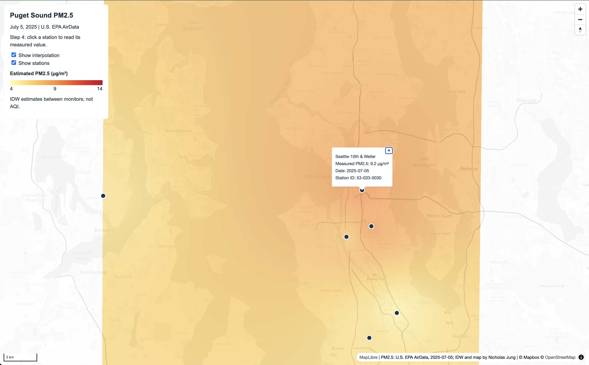
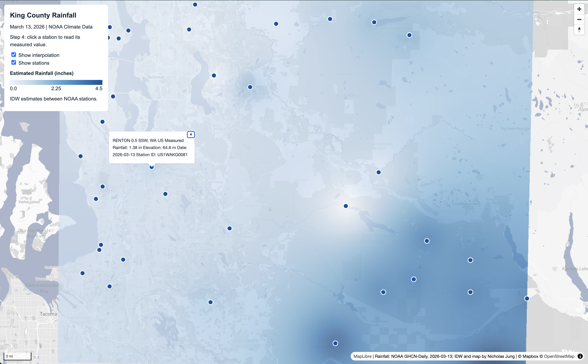

# GEOG 458 Lab 3: Basemap Design and Tile Generation

**Author:** Nicholas Jung  
**Live Guided Map:** [Puget Sound PM2.5](https://nickjung0526.github.io/nickjung0526/lab3/nicholasjung_lab3-1.html)  
**Live Independent Map:** [King County Rainfall](https://nickjung0526.github.io/nickjung0526/lab3/nicholasjung_lab3-2.html)

---

## 1. Guided Map: Puget Sound Air Quality (`nicholasjung_lab3-1.html`)
* **Purpose & Audience:** This map visualizes fine particulate matter ($\text{PM}_{2.5}$) concentrations to help local residents and health officials identify regional air quality patterns and localized hotspots.
* **Study Area & Zoom Range:** Central Puget Sound corridor from Tacoma to Marysville. Exported for **Zoom levels 8–12** with a bounding box of `[-122.75, 47.10, -122.05, 48.15]`.
* **Data Sources:** 
  * Basemap: Mapbox Light template.
  * Thematic Data: U.S. EPA AirData daily summary for July 5, 2025 (11 monitoring stations).
* **Processing & Design:**
  * **Basemap (`assets/mapbox-guided`):** Edited in Mapbox Studio to exclude five commercial POI classes (`commercial_services`, `store_like`, `food_and_drink`, `food_and_drink_stores`, `lodging`) to reduce clutter. Modified the `motorway` class line colors to a darker neutral gray across road, bridge, and tunnel layers to establish a clear visual hierarchy.
  * **Thematic Raster (`assets/pm25-guided`):** Station points were reprojected to EPSG:32610 (UTM Zone 10N) in QGIS. An Inverse Distance Weighting (IDW) interpolation was run with a 250 m pixel size and distance coefficient of 2.0. The resulting surface was styled with a 5-class linear pseudocolor ramp (4.0 to 14.0 $\mu\text{g/m}^3$) and exported as transparent PNG tiles in EPSG:3857.

  

  --

  ## 2. Independent Map: King County Rainfall (`nicholasjung_lab3-2.html`)

* **Purpose & Audience:** This map illustrates the orographic precipitation effect across King County during a major storm, helping meteorologists and local water management understand how rainfall totals drastically increase from the lowland Puget Sound to the high-elevation Cascade Range. 
* **Study Area & Zoom Range:** King County, WA (from Seattle eastward to Stampede Pass). Exported for **Zoom levels 8–12** with a widened bounding box of `[-122.55, 47.05, -121.20, 47.85]` to capture the high-elevation stations. 
* **Data Sources:**
  * Basemap: Mapbox Dark/Outdoors template.
  * Thematic Data: NOAA Climate Data Online (Custom GHCN-Daily CSV) for March 13, 2026.
* **Processing & Design:**
  * **Basemap (`assets/mapbox-independent`):** A custom Mapbox style was published and exported via QMetaTiles with 0% background transparency.
  * **Thematic Raster (`assets/rainfall-theme`):** The NOAA CSV was filtered to 49 active King County stations on 2026-03-13. The data was projected to EPSG:32610 for IDW interpolation (250 m pixel size, $P=2.0$). The precipitation raster (`PRCP`) was styled using a 5-class Equal Interval "Blues" color ramp (0.0 to 4.5 inches) and exported as transparent PNG tiles in EPSG:3857. The filtered vector data was exported as a GeoJSON to drive the interactive browser popups.

---

## 3. Raster Snapshots vs. Vector Interaction (Estimates vs. Measurements)

This lab utilizes two different data models to balance web performance with user interactivity:

1. **Raster Snapshots (Estimated Values):** The `pm25-guided` and `rainfall-theme` tile pyramids are pre-rendered `.png` images. Because they are just flat image files served by a local directory, the web browser can load and pan across them without having to recalculate complex spatial math. However, these colors represent mathematical estimates (interpolated via IDW) rather than physical truth. Because they are static images, the original numeric data is lost—a user cannot click a pixel to retrieve its underlying value or modify the attribute table.
2. **Interactive Vector Data (Measured Values):** To provide actual data to the user, we overlay the original GeoJSON point files (`pm25_stations.geojson` and `rainfall_stations.geojson`). Unlike the raster tiles, vector layers preserve the discrete geometry and the raw attribute table. This allows the web map to utilize MapLibre's JavaScript event listeners so that when a user clicks a specific point, a popup dynamically queries and displays the true, measured physical value recorded by that specific monitoring station on that exact date.

